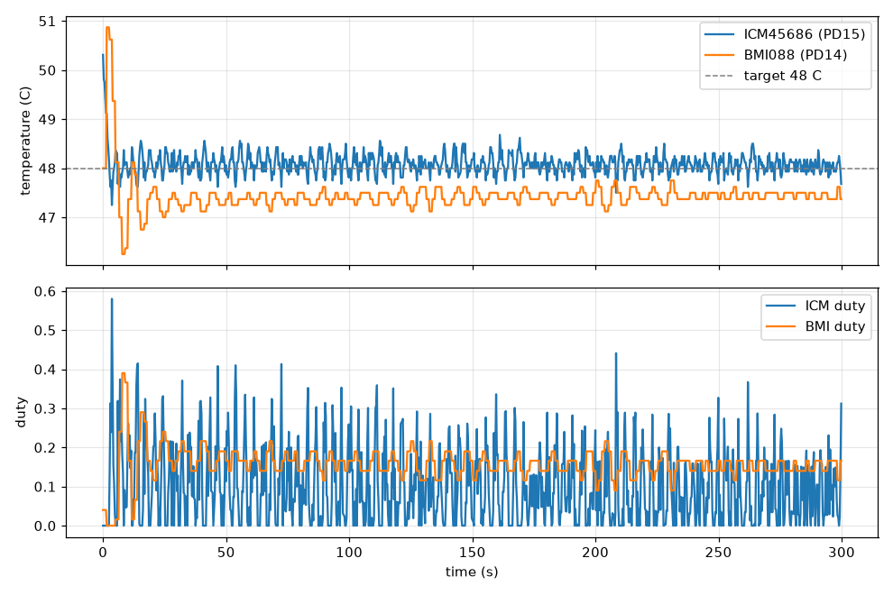

# DM-FC01 Betaflight 固件（非官方）

`config.h` 是 DM-FC01 的 Betaflight 板级配置，本目录是唯一一份。官方 `betaflight/config` 里没有这块板。
`patches/0001-imu-heater.patch` 是本地加的 IMU 恒温加热功能（上游没有）。

## 传感器支持

| 器件 | Betaflight 驱动 | 状态（2026-10-14 上板） |
| --- | --- | --- |
| ICM45686（SPI4） | `accgyro_spi_icm456xx`，2025.12.1 起正式支持 | 主陀螺（GYRO_1），6.4 kHz，数据正常 |
| BMI088（SPI1，陀螺/加计各一根 CS） | 未合入的 [PR #15771](https://github.com/betaflight/betaflight/pull/15771) | 副陀螺（GYRO_2）；单独启用时 2 kHz，加计 1 g ≈ 2704（12 g 量程），方向实测正确 |
| SPA06-003（I2C1，0x77） | `USE_BARO_SPA06_003`，走 DPS310 驱动的 SPL07_003 分支 | `status` 显示 `SPA06_003`，说明芯片 ID 确为 0x11；静止时高度抖动几厘米 |
| W25Q128（SPI2） | `flash_w25q128fv` | JEDEC 0xEF4018，16 MB，黑匣子默认设备 |
| TF 卡（SDMMC1） | `sdcard_sdio` | `Startup failed`，是否插卡待确认 |

BMI088 陀螺 ODR 上限 2 kHz，ICM45686 可到 6.4 kHz 以上，所以主陀螺用 ICM45686。

Betaflight 不管的两个脚用 PINIO 在传感器探测前钉住：PB5 拉高（SPA06 地址 0x77）、PE15 拉低（关外部 SBUS
反相器，H7 用 UART 内部反相）。

`status` 里的 `I2C ... (14 errors)` 来自罗盘自动探测（外部 I2C4 上没接东西）。实测 `mag_hardware = NONE` 时为 0。
默认保留 AUTO，这样接上 GPS 罗盘能自动识别。

## IMU 恒温加热（本地补丁）

Betaflight 没有加热功能，补丁里加了：

- 两个驱动读芯片温度（`temperatureFn`）：ICM45686 读 0x0C/0x0D，温度 = 25 + raw/128 °C（TDK 官方驱动示例）；
  BMI088 读加计 die 的 0x22/0x23，11 位补码，温度 = 23 + raw × 0.125 °C（手册 5.3.7，PX4 同款）。
- BMI088 的温度传感器在**加计 die** 上，而它当副 IMU 时 Betaflight 不会初始化这颗 die（上电默认 suspend，温度不更新）。
  补丁在陀螺初始化时单独建一个 SPI 设备把加计 die 切到 active。
- `sensors/imu_heater.c`：第 n 路加热器按 GYRO_n 的温度做 PI 闭环，10 Hz 控制，GPIO 软件 PWM（任务 1 kHz、周期 100 ms）。
  控制律同 PX4 heater（前馈 + 比例 + 积分限幅 ±0.25），另加积分抗饱和。
  以下情况立即关断并清积分：读数超出 −40～80 °C、高于目标 10 °C、连续 1 s 读失败、拿到第一个有效读数之前。

| 参数 | 含义 | 默认（达妙 PX4 出厂值换算） |
| --- | --- | --- |
| `imu_heater_target` | 目标温度 °C，0 = 关 | 48 |
| `imu_heater_p` | 比例，占空比 %/°C（ICM, BMI） | 65, 20 |
| `imu_heater_i` | 积分，占空比 0.1 %/(°C·s) | 100, 0 |
| `imu_heater_ff` | 前馈占空比 % | 2, 4 |

达妙的值来自 `CaFeZn/PX4-Autopilot` 的 `rc.board_defaults`（`HEATERn_TEMP*`）。换算时**假设**它的积分和 PX4 上游一样
每 10 ms 累加一次（达妙改过的多路 heater 驱动源码没核对）。

### 实测（2026-10-14，只接 USB，室温，桌面静置）



| | 稳态均值（最后 180 s） | 标准差 | 范围 | 平均占空比 |
| --- | --- | --- | --- | --- |
| ICM45686（PD15） | 48.07 °C | 0.17 °C | 47.50～48.68 °C | 0.090 |
| BMI088（PD14） | 47.44 °C | 0.12 °C | 47.12～47.75 °C | 0.153 |

- 加热器功率相对于芯片热容很大，满占空比时升温超过 2 °C/s：从 40 °C 冷态到 48 °C 只要几秒，在重启的空档里就升完了，
  所以曲线开头没记录到升温段。冷启动会过冲一次：ICM 约 +2.3 °C，BMI 约 +2.9 °C，远低于 +10 °C 的关断线。
- 最初用 1 s PWM 周期：单个开周期就能过冲，ICM 稳态标准差 0.27 °C、范围 1.5 °C。改成 100 ms 后降到 0.17 °C、1.18 °C。
- BMI 稳态偏低约 0.5 °C：沿用达妙的 I = 0，只有 P + 前馈，有静差。它的温度寄存器每 1.28 s 才更新一次，
  而升温速度很快，这个滞后限制了闭环精度。偏差是恒定的，对零偏稳定没有影响，所以没改达妙的参数。
- 改 `imu_heater_target` 要 `save` 重启才生效。目标设为 0 时两路占空比都是 0，自然冷却到约 40/36 °C
  （MCU 本身约 42 °C，会把板子捂热）。

看温度：`set debug_mode = IMU_HEATER`，debug[0]/[2] 是两路温度（0.01 °C），debug[1]/[3] 是占空比（0.001），
可用 MSP_DEBUG 读或在黑匣子里看。资源名 `IMU_HEATER 1/2`（PD15 = ICM45686，PD14 = BMI088）。

## 构建

源码放在仓库同级 `../betaflight`，分支 `dm-fc01` = PR #15771 分支（基于 master e5071ce4e，HEAD 437815d8c）+ 本目录补丁：

```bash
cd ~/robomater/betaflight
git fetch origin pull/15771/head:pr-15771-bmi088        # 首次
git switch -c dm-fc01 pr-15771-bmi088                  # 首次
git apply ~/robomater/vio/DM-FC01/betaflight/patches/0001-imu-heater.patch   # 首次
git submodule update --init src/config                 # 首次
make arm_sdk_install                                   # 首次，装 GCC 13.3 到 tools/
mkdir -p src/config/configs/DAMI/DM_FC01
ln -sf ~/robomater/vio/DM-FC01/betaflight/config.h src/config/configs/DAMI/DM_FC01/config.h
make CONFIG=DM_FC01 -j6
# 产物：obj/betaflight_<版本>_STM32H743_DM_FC01.hex
```

单元测试要 clang：Ubuntu 22.04 上装 `clang` 和 `libstdc++-12-dev`（不装后者会报找不到 `cstddef`），然后跑 `make test`。

## 刷写

DFU 用 `dfu-util`（不用装 Configurator）。hex 要先转成填 0xFF 的 bin：

```bash
arm-none-eabi-objcopy -I ihex -O binary --gap-fill 0xFF obj/betaflight_*_DM_FC01.hex obj/DM_FC01.bin
dfu-util -a 0 -s 0x08000000:leave -D obj/DM_FC01.bin
```

- 进 DFU：第一次要按住 boot 键插 USB；已经跑 Betaflight 后，在 CLI 里输入 `bl` 即可（这版 `bl rom` 不生效，原因没查）。
- `:mass-erase` 在 dfu-util 0.9 上会因 get_status 超时失败，不加它，按扇区擦就行。
- 这个 bin 覆盖了配置扇区（0x08020000，已填 0xFF），**刷一次就等于恢复出厂设置**，有改过的参数先 `diff all` 存下来。
- 结尾的 `Error during download get_status` 是 `leave` 后设备已复位，属正常。

## 已验证

**桌面（2026-10-14）**
- 编译零 warning，FLASH1 占用 613 KB / 1792 KB；`make test` 87 个测试套件、1132 项全部通过。
- 加热器的安全逻辑做了变异测试：把超温关断、连续读失败关断、积分抗饱和、初始化拉低、首次读数前不加热
  分别去掉，各自都有测试变红。

**上板（2026-10-14，只接 USB）**
- 两颗 IMU、气压计、Flash 识别正常；`resource` 与配置一致；CPU 16%，陀螺 6.4 kHz。
- ICM45686 平放时加计 z = 2048（1 g），陀螺静止时在 ±1 以内。
- **安装方向（以板上箭头为机头）：ICM45686 为 `CW90_DEG`**，手持倾斜实测确认：压机头 pitch +18～+24°、roll 约 −1°；
  压右侧 roll +30～+37°、pitch 约 0°。按 PX4 `-R 4`（YAW_180）推出的 `CW180_DEG` 是错的，差 90°：
  压机头显示成右倾，压右侧显示成抬头。Betaflight 约定：机头朝下 pitch 为正，右侧朝下 roll 为正（`flight/imu.c:818`）。
  这一版 CLI 里没有陀螺方向参数，只能在 `config.h` 里改了重新编译。
- **BMI088 同样是 `CW90_DEG`**：`set gyro_enabled_bitmask = 2` 单独启用后实测，压机头 pitch +28～+32°、roll 约 −1°；
  压右侧 roll +22～+33°、pitch 约 −5°（倾斜时带了一点俯仰）。测完已改回 `gyro_enabled_bitmask = 1`。
- 两颗 IMU 采样率不同（6.4 kHz / 2 kHz）。Betaflight 的多陀螺功能只对采样率、量程都相同的陀螺求平均，
  否则开机时自动只留第一颗，所以这块板上同时启用两颗没有作用（`sensors/gyro_init.c`）。
- 修过的问题：H743 的 VREFINT 在 ADC3，配置漏了 `ADC3_DMA_OPT`，导致 Vref 读成 0.09 V、空载电压显示 13.7 V。补上后 Vref 3.31 V，空载 0 V。
- 加热：两路闭环工作正常，结果见上文「实测」一节。

## 上板检查清单（待做）

1. 电机页逐个转 M1–M8，核对编号和 DShot。
2. 电压/电流校准：`vbat_scale` 默认 102、`ibata_scale` 默认 490（按 ArduPilot 参数换算）。
   达妙 PX4 给的是 `BAT1_V_DIV 10.1`、`BAT1_A_PER_V 17`（换算后约 101、588），两家数据不一致，必须实测。
3. TF 卡：插卡后看 `sd_info`。
4. 接收机：CRSF/SBUS 接 RC_INPUT（UART5）。
5. LED：蓝 PB15 / 绿 PD11 / 红 PE12。

## 还原 PX4

整片 Flash 的备份在 `backup/dm-fc01_px4_full_20261014.bin`（2 MB，含 bootloader、PX4 v1.16.0 和参数，
sha256 `20482007…a1293`，两次读出一致）。进 DFU 后：

```bash
dfu-util -a 0 -s 0x08000000:leave -D backup/dm-fc01_px4_full_20261014.bin
```

⚠️ **不要用 `../固件/PX4/DM-FC01_bl.bin`（以及同名 .hex）**：里面是 `%BOARD%`、`NxtPX4v2` 等字符串，是模板或其它板的
bootloader，与本板实际的不一致。本板实际的 bootloader（`PX4BLv1.16.1 DAMIAO DM-FC01`，43288 字节）与
`../固件/PX4/damiao_dm-fc01_bootloader.px4` 里的镜像逐字节相同。

## 引脚来源

- 达妙 PX4 板级源码 `CaFeZn/PX4-Autopilot` 分支 `damiao_dm-fc01`，文件 `boards/damiao/dm-fc01/`
  （spi.cpp、board_config.h、timer_config.cpp、board.h、rc.board_sensors、rc.board_defaults），与出厂固件一致。
- `../说明书/DM-FC01开发手册.md`。
- `../说明书/FirstFlightControler.ioc` 是早期工程：ICM45686 被标成双 CS（PC2/PC13）、双 DRDY（PE3/PE4），
  也缺 PD4、PE12、PE15，**不作依据**。
