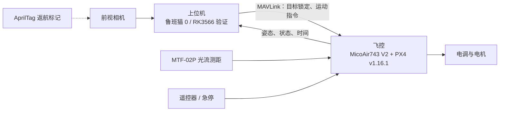

# RoboMaster 空中机器人：机载视觉与自主飞行

华中科技大学狼牙战队（HUSTLYRM）面向 RMUC 2027 全自动空中机器人的机载软件仓库。
飞控跑 PX4，上位机经 MAVLink 下发指令，负责目标识别、锁定和任务流程。

> 本仓库处于原型阶段：飞行程序只在仿真中跑通，视觉只在桌面验证过，**还没有实物飞行**。
> 各结论的日期和依据见 [`AGENTS.md`](AGENTS.md) 与 [`docs/项目计划书.md`](docs/项目计划书.md)。

## 要做什么

| 任务 | 上位机负责 | 现状 |
| --- | --- | --- |
| 撞装甲板 | 识别装甲板灯条、区分敌我颜色、跟踪并引导撞击 | 未开始 |
| 拦截飞镖 | 识别飞镖上的灯点、跟踪锁定、引导拦截 | 识别与跟踪原型（`vision/`） |
| 定点返航 | 识别 AprilTag，给出相对位姿，引导返航降落 | 计划中；**规则是否允许贴标记待确认** |
| 自主起降、悬停、航点 | 经 MAVLink Offboard 控制 PX4 | 程序完成，仿真通过（`flight/`） |

**分工（2026-10-23 定）**：上位机只做识别和锁定，**不跑视觉里程计**；
定位由下视光流测距（MTF-02P）+ 飞控 EKF 承担，返航的绝对参照用 AprilTag。
依据是鲁班猫上的实测耗时，见计划书 3.4 节。

## 系统组成



| 部件 | 当前 | 说明 |
| --- | --- | --- |
| 上位机 | 野火鲁班猫 0（RK3566，4×A55 1.8 GHz，Ubuntu 20.04） | 开发验证板。最终方向是自研飞控电调一体板（设计中，资料未入库） |
| 相机 | 野火 ov8858 模组（卷帘快门，30 fps） | 能用但不适合高速目标，全局快门高帧率相机待选型 |
| 飞控 | MicoAir743 V2，上游 PX4 v1.16.1 | 2026-10-11 由达妙 DM-FC01 更换而来 |
| 定位 | MTF-02P 光流 + 测距，经 MAVLink 进飞控 | |

接线、引脚和参数以 [`docs/硬件接线与配置手册.md`](docs/硬件接线与配置手册.md) 为准。

## 目录

| 路径 | 内容 |
| --- | --- |
| [`flight/`](flight/) | 机载自主飞行程序（pymavlink）：自检 → 起飞 → 悬停 → 航点 → 降落，含失效保护。详见 [`flight/README.md`](flight/README.md) |
| [`vision/`](vision/) | 灯点识别与跟踪：颜色阈值检测、卡尔曼跟踪、MJPEG 调试推流 |
| [`sim/`](sim/) | PX4 v1.16.1 SITL（Docker），用于在没有实物时验证 `flight/` |
| [`stereo/`](stereo/) | USB 双目相机的采集、标定与 C++ 轻量双目 VO（笔记本评估成果，**不上机**） |
| [`tools/preview.py`](tools/preview.py) | 鲁班猫摄像头实时预览（板上零依赖，经 SSH 传回本机浏览器查看） |
| [`tests/`](tests/) | pytest 单测（飞行状态机、MAVLink 收发、识别等价性、双目工具等） |
| [`DM-FC01/`](DM-FC01/) | 达妙 DM-FC01 飞控的厂家资料与非官方 Betaflight 配置（已不作为主飞控，留作参考） |
| [`docs/`](docs/) | 项目计划书、硬件接线与配置手册 |
| [`AGENTS.md`](AGENTS.md) | 项目实测事实、踩过的坑与待确认事项（给接手的人和 AI 助手看的必读入口） |

## 快速开始

### 环境

本机（Ubuntu 22.04）用 [uv](https://docs.astral.sh/uv/) 管理 Python 依赖。代码要兼容鲁班猫上的 **Python 3.8**。

```bash
uv sync
uv run pytest            # 需要 numpy/cv2 的测试在 uv 环境里会自动跳过
```

识别和双目相关的测试依赖 numpy、OpenCV（双目还要 PyYAML），用装了这些包的系统 Python 跑：

```bash
python3 -m pytest tests/test_vision_detector.py tests/test_vision_cpu_freq.py tests/test_stereo_*.py
```

### 自主飞行程序（仿真）

PX4 源码默认放在仓库同级的 `../PX4-Autopilot`（v1.16.1 + 子模块），容器内编译运行，宿主机不用装 PX4 工具链。

```bash
sim/sitl.sh src      # 拉 PX4 源码（一次）
sim/sitl.sh image    # 构建镜像（一次）
sim/sitl.sh build    # 编译（一次）
sim/sitl.sh sih      # 启动 SIH 四旋翼
uv run python -m flight.run_mission --url udpin:0.0.0.0:14540 --no-rc --mission sim/sih_square.json
```

上实物前必须读 [`flight/README.md`](flight/README.md) 的安全行为和装机首飞检查清单。
**真正的急停永远是遥控器 Kill 开关**；在板上请放进 tmux 运行，SSH 断线会让程序中止（空中会降落）。

> 注意：`flight/` 里的串口链路和参数是按旧飞控 DM-FC01 写的，换成 MicoAir743 后需要按硬件手册重做，不能直接套用。

### 灯点识别（鲁班猫上）

板上用 `~/vio_venv` 里的解释器（含 numpy、OpenCV、loguru）：

```bash
~/vio_venv/bin/python3 vision/dart_tracker_main.py --port 8091
# 浏览器打开 http://<板子IP>:8091/ 看标注画面
#   --min-freq-mhz 1800   运行期间 CPU 最低频率（默认 1800，退出时恢复；0 = 不改）
```

- 直接读相机的 YU12 原始帧，后台线程只保留最新帧；识别结果与原整帧 HSV 算法逐像素一致（`tests/test_vision_detector.py`）。
- 鲁班猫实测（640×480，30 fps）：帧尾时间戳到识别完成中位约 17 ms，识别本身约 7.5 ms。
- 目前检测蓝色和红色灯点，阈值还没用真实飞镖灯复核。

摄像头预览（在本机运行，默认连 OTG 地址 `10.42.0.50`，浏览器开 http://127.0.0.1:8090）：

```bash
python3 -X utf8 tools/preview.py
```

预览独占摄像头，和识别程序不能同时跑。

### 双目 VO（笔记本评估，不上机）

```bash
cmake -S stereo/vo -B stereo/vo/build && cmake --build stereo/vo/build -j4
stereo/vo/build/test_vo                              # 单测
stereo/vo/build/stereo_vo --replay <录制目录> --skip 3   # 离线回放
```

标定、录制和评估方法见 [`AGENTS.md`](AGENTS.md) 5.8 节。2026-10-23 起机载不跑视觉 VO，这部分不再继续投入。

## 连接鲁班猫

网线直连（主）和 USB OTG（备）两条通道，地址与注意事项见 [`AGENTS.md`](AGENTS.md) 第 1 节。

## 贡献约定

- 提交信息用中文，说清改了什么、为什么。
- 新功能配 `tests/test_xxx.py`；修 bug 先写能复现的失败测试。
- 日志、ulog、录像、相机裸帧不入库（见 `.gitignore`）。
- 结论标注来源：**实测** / **手册** / **待确认**，不把推测写成事实。
