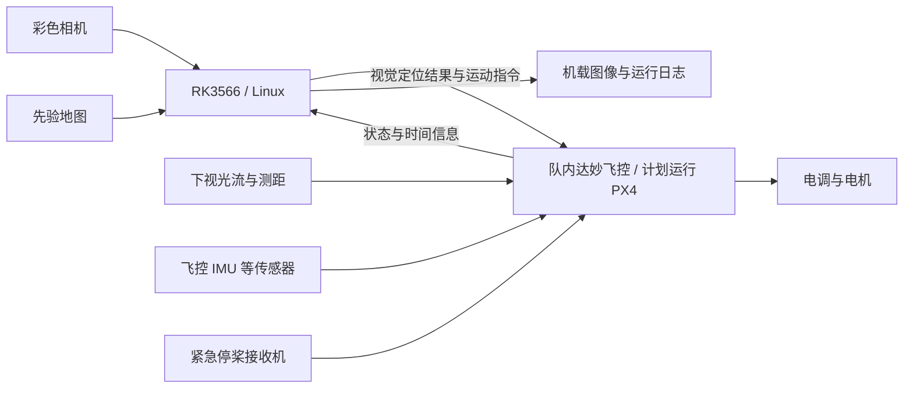

# 轻量化竞赛无人机视觉与飞控一体化项目计划书

更新日期：2026-09-14  
状态：方案基线已确定，进入硬件核实与原型准备阶段。

本文是项目计划的唯一维护入口。需求、选型和阶段结论在本文原位更新，不另建平行版本。

## 1. 项目目标

面向 RoboMaster 竞赛空中机器人，构建轻量化、机载自主运行的视觉与飞控系统。先实现自主起飞、悬停、短距离移动和回库，再扩展场地巡航、信息采集与竞赛任务感知。

最终硬件方向为 RK3566 视觉计算与飞控的一体化板。第一阶段复用队内达妙飞控和现成计算板，先验证软件与传感器链路，再设计轻量化硬件。

用户描述的后续竞赛任务包含飞镖拦截和机器人碰撞；目标带蓝、橙等常亮灯。本计划先建设定位、感知和基本自主飞行能力，不以灯光识别成功作为上述完整任务已经可行的证明。动态目标任务另行开展可行性评估，第一阶段不实现自动碰撞或拦截动作。

## 2. 已知条件与需求边界

### 2.1 用户已确认

| 项目 | 当前结论 |
| --- | --- |
| 视觉处理器 | 确定使用 RK3566，不再平行推进 RV1126B 选型 |
| 飞控硬件 | 第一阶段复用队内达妙飞控；具体型号、MCU 和接口未核实 |
| 飞控软件 | 计划采用 PX4，须确认现有达妙飞控的支持情况 |
| 传感器 | 彩色相机、下视光流测距模块、飞控已有惯性传感器 |
| 地图 | 用户表示有场地尺寸图/CAD、三维模型及视觉地图；实际文件、坐标系和可用性待检查 |
| 场景 | 有先验地图，现场存在移动物体、遮挡及其他干扰 |
| 目标外观 | 蓝、橙等常亮灯；几何布局、尺寸和可区分性未确认 |
| 回库 | 需要较高精度，具体指标留到功能验证阶段定义 |
| 尺寸 | 暂不采用早先“10 mm 立方”的描述作为约束 |

### 2.2 规则输入

依据用户提供的 RMUC 2027 规则截图摘录，尚未完成对完整规则及修订版本的核对：

- 运行方式为全自动，在机库内可以和机库通信。
- 持续悬停能力至少 10 秒；这不是整段任务的续航要求。
- 需要全包围桨叶保护罩、柔性桨叶，以及紧急停桨遥控器/接收机和安全员。
- 不允许安装发射机构；最大供电总容量和最大工作电压在截图中为待定。
- 重量与尺寸联动：`y = -0.001225x + 0.3225`，`y ∈ [0.15, 0.249]`；其中 `y` 为 kg，`x` 为 mm，整机长、宽、高分别不得超过 `x`。
- 依该公式，249 g 对应 60 mm，200 g 对应 100 mm，150 g 对应约 140.8 mm。249 g 是上限，不是必须达到的设计重量。

原型桌面验证可以使用较大的开发板；确定上机结构前必须回到完整规则核算。不能从“机库内可以通信”推断离库后也允许地面计算或通信。

## 3. 系统方案

### 3.1 原型组成

RK3566 运行 Linux 和视觉/任务程序；PX4 是运行在飞控上的软件，不是额外的硬件板。计算侧与飞控侧优先通过串口 MAVLink 连接，电平、串口资源和协议配置在接线前核实。

### 3.2 职责划分

| 子系统 | 职责 | 首阶段边界 |
| --- | --- | --- |
| 飞控与 PX4 | 姿态稳定、状态估计、电机输出、失效处理 | 沿用已有飞控功能，不从零重写控制器 |
| 下视光流测距 | 提供图像运动与距离观测，辅助速度估计和悬停 | 不视为绝对地图定位或无漂移位置来源 |
| RK3566 | 图像采集、灯光候选识别、定位扩展、任务管理、日志 | 先运行传统视觉方法，不默认需要神经网络 |
| 先验地图定位 | 给出场地坐标下的位置校正与重定位 | 获取实际地图后选择算法，不预设已有地图可直接使用 |
| 回库视觉 | 识别机库参照、评估相对位置并辅助降落 | 不假设允许添加人工标记，需核实规则与实物条件 |
| VIO | 连续三维位姿估计的可选增强 | 保留 OpenVINS 验证路线，不作为首次悬停的前置条件 |

### 3.3 关键认识

1. 光流主要提供相对运动约束，位置累计会漂移；悬停稳定不等于能够巡航后精确回库。
2. 光流看到大面积移动机器人、反光或低纹理表面时可能退化；测距越过车顶时也会发生变化。
3. 常亮彩灯可以作为识别线索，但没有独立编码。同色灯、反光、遮挡和过曝需要在实景数据中验证。
4. 单个灯点通常不能直接给出可靠距离；相对位姿能力取决于可见结构、已知尺寸和标定条件。
5. NPU 的 TOPS 不代表传统视觉或 VIO 的实际性能；根据端到端延迟和资源占用决定是否优化或增加算法。

## 4. 硬件选型基线

| 部件 | 当前选择 | 未完成事项 |
| --- | --- | --- |
| RK3566 验证板 | Radxa ZERO 3W 为候选，内存先按 2 GB 评估 | 核实具体版本、供货、相机支持与供电 |
| 轻量核心板 | Boardcon CM3566 为候选 | 核实样品报价、SDK、底板资料和装配工艺 |
| 飞控 | 队内达妙飞控 | 获取型号/照片、确认 PX4 固件目标和传感器接口 |
| 飞控自研方向 | STM32H743 + PX4 | 属于后续方向，不推定达妙飞控就是 H743 |
| 彩色相机 | 未定 | 与验证板绑定选型，确认驱动、曝光控制、时间戳和动态成像表现 |
| 光流测距 | MTF-01 为验证候选 | 检查已有模块、协议、安装空间及有效工作范围 |
| 电调/电机/电池/接收机 | 优先复用队内合适器件 | 型号、质量和电气兼容性待登记 |

CM3566 厂家标称 47×40 mm、8.6 g，支持多个内存配置，需要配套或自研底板。8.6 g 不含飞控、底板、相机、线材、供电与散热。模块集成路径仍包含核心模块和载板；若最终要求所有芯片直接位于同一 PCB，则需另评估处理器、DDR、存储和电源的完整设计工作。

MTF-01 厂家标称 4.5 g、0.5 W，测距最高 8 m 有反射率和光照条件；不能按“1.5～3 g、低于 0.3 W、10 m 内通用”计入预算。

第一版优先采用外置光流模块和独立电调。一体板先整合必要的计算与飞控功能，避免同时引入过多未验证硬件。

## 5. 分阶段实施与验收

阶段按完成条件推进，暂不承诺缺少硬件和人员信息支撑的日历工期。

### 阶段 A：硬件与资料核实

任务：

- 登记达妙飞控、接收机、电调、现有传感器的准确型号与固件。
- 查明达妙飞控是否有匹配的 PX4 支持目标，确认光流、MAVLink 串口及日志功能。
- 核实 RK3566 验证板与彩色相机组合；形成具体采购清单和接线表。
- 整理实际地图、机库资料和完整竞赛规则。

交付：硬件清单、接线表、固件与驱动版本记录、地图与规则输入清单。

验收：每个连接都有明确的引脚、电平、供电和协议依据；没有把“厂家名称相同”当作固件兼容证据。若达妙飞控不支持 PX4，先记录缺口，再决定移植或更换验证飞控，不能静默刷入其他型号固件。

### 阶段 B：桌面联调

任务：

- RK3566 启动 Linux，运行可复现的图像采集与日志程序。
- 接入相机，验证曝光、白平衡、分辨率及帧率控制能力。
- 接通飞控 MAVLink 状态链路，读取传感器和飞控状态。
- 接通光流测距，核对方向、质量信息、距离和时间信息。
- 在拆桨条件下验证紧急停桨链路、断连处理和指令超时行为。

交付：采集/通信原型、配置说明、桌面测试记录。

验收：日志可追溯到所用硬件和配置；手动移动/旋转时观测方向正确；相机断开和通信中断能够被明确识别；不以“串口收到数据”作为系统功能正确的唯一证明。

### 阶段 C：基本飞行验证

任务：

- 在受控场地完成基础飞控调试和光流测距校准。
- 先验证稳定悬停，再验证自主起飞、短距离移动和降落。
- 记录不同地面纹理、光照、飞行高度及遮挡下的表现。
- 使用独立视频参照、测量标记或可用的外部测量设备评估实际移动与漂移。

交付：飞行日志、视频、误差与失败场景记录。

验收：完成规则截图中的至少 10 秒悬停能力验证；自主起降和短距离移动可重复完成。悬停偏移和重复次数在首次受控实验前确定，不将试验中观察到的结果事后改成验收门槛。

### 阶段 D：视觉与定位验证

任务：

- 采集真实场地的蓝橙灯、背景灯、反光、遮挡与曝光变化数据。
- 建立颜色/亮度/几何特征识别基线，记录误检、漏检和连续跟踪表现。
- 检查先验地图是否能支撑可重复定位，验证地图校正与光流累计位置的关系。
- 若光流无法满足定位连续性需求，再开展 OpenVINS 的相机—IMU 同步、标定与性能验证。
- 独立验证机库识别及相对位置估计，随后接入返回与降落流程。

交付：可回放数据、视觉基线、定位评估、回库方案。

验收：以独立测试片段评估，不能只展示成功视频；没有稳定识别时输出无效状态；明确回库误差和定位失效条件。视觉识别验收不等于动态竞赛动作验收。

### 阶段 E：轻量化硬件与一体板

进入条件：原型已经明确所需接口、算法资源和实际电气负载。

任务：

- 分项称重并测量空闲、正常运行和最高预期负载下的功耗与温升。
- 选择核心模块加飞控载板，或进一步做全芯片单 PCB；评估资料、加工与返修能力。
- 完成电源、飞控、相机连接、调试接口、时间同步及结构安装设计。
- 制板前完成独立硬件审查；若无人可审查，显式记录未完成项。
- 新板完成桌面验证和基本飞行回归后，再替换原型系统。

交付：原理图、PCB、BOM、装配资料、固件板级配置、测试记录。

验收：完整上机系统满足最终核实的质量与尺寸要求；持续运行无非预期复位和不可接受的降频；原型阶段的必要功能在新板上回归通过。

## 6. 度量与预算原则

| 度量 | 记录方式 | 当前状态 |
| --- | --- | --- |
| 上机质量 | 计算板/底板、飞控、相机、光流、供电、散热、线材、安装件逐项称重 | 未实测 |
| 功耗 | 在实际供电入口记录电压电流，同时注明任务和外设配置 | 未实测 |
| 视觉延迟 | 尽量从采集时间到结果输出测量，记录平均值、P95 和最大值 | 未实测 |
| 资源 | 记录 CPU、内存、温度、频率与丢帧情况 | 未实测 |
| 定位质量 | 使用独立参照评估漂移、失败次数和恢复行为 | 未定义最终阈值 |
| 回库质量 | 记录进入机库区域、对准和落点的实际结果 | 待机库资料到位 |
| 采购预算 | 区分桌面开发套件、上机件、加工与备件 | 待具体报价 |

开发板电源适配器额定值不是运行功耗；核心板净重不是完整系统重量；算法 FPS 不是整个闭环的响应速度。

## 7. 当前任务清单

- [x] 确定 RK3566 计算路线。
- [x] 确定优先复用队内达妙飞控。
- [x] 确定 PX4 为计划采用的飞控软件。
- [x] 确定下视光流测距作为初期悬停基线。
- [ ] 获取达妙飞控准确型号及当前固件，确认 PX4 支持情况。
- [ ] 选定可供货的 RK3566 验证板和已支持的彩色相机组合。
- [ ] 核实光流模块及其他队内现有器件。
- [ ] 整理实际地图、机库资料与完整规则版本。
- [ ] 形成采购清单与接线表，进入桌面联调。

当前未进行采购、刷写、硬件接线或飞行测试；本文不代表实际系统已验证通过。

## 8. 参考资料

以下资料用于当前方案论证，实际实施时按所选硬件和固件版本核对：

1. [RK3566 简版数据手册](https://www.rock-chips.com/uploads/pdf/2022.8.26/191/RK3566%20Brief%20Datasheet.pdf)
2. [Radxa ZERO 3 官方文档](https://docs.radxa.com/en/zero/zero3)
3. [Radxa ZERO 3 相机支持列表](https://docs.radxa.com/en/zero/zero3/accessories/camera)
4. [Boardcon CM3566 核心板](https://www.armdesigner.com/cn/Rockchip_RK3566_SOM/)
5. [PX4 光流说明](https://docs.px4.io/main/en/sensor/optical_flow)
6. [PX4 外部位置估计接入](https://docs.px4.io/main/en/ros/external_position_estimation)
7. [PX4 自定义飞控板移植指南](https://docs.px4.io/main/en/hardware/porting_guide)
8. [MTF-01 厂家规格与接入说明](https://micoair.com/optical_range_sensor_mtf-01/)
9. [OpenVINS 文档](https://docs.openvins.com/)
10. [OpenVINS 传感器标定](https://docs.openvins.com/gs-calibration.html)
